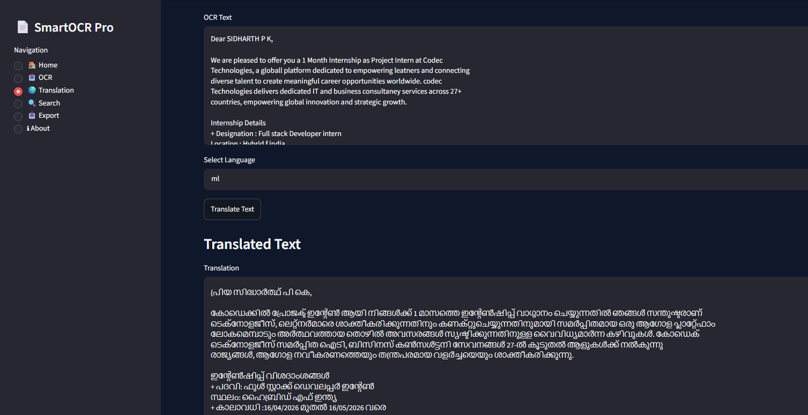

# SmartOCR Pro

A web-based document recognition and processing system built with Python that extracts text from images and scanned PDFs, supports keyword search, and provides text export options.

## Live Demo

Try SmartOCR Pro here: https://smartocr-pro-v2-xz6swrd5txbp6c6d2nuew4.streamlit.app/


## Features

- **Image OCR:** Extract text from uploaded images using Tesseract OCR and OpenCV.
- **PDF OCR:** Extract text from scanned PDF documents.
- **Multilingual OCR:** Support for English, Hindi, Malayalam, Kannada, and Tamil, depending on installed Tesseract language packs.
- **Keyword Search:** Search extracted text for specific keywords.
- **Text Export:** Download extracted text as TXT or PDF files.
- **Translation:** Translate extracted text into supported languages using Google Translate through `deep-translator`. Availability may be affected by external rate limits.

## Tech Stack

- Python
- Streamlit
- OpenCV
- Tesseract OCR
- PyTesseract
- pdf2image
- Poppler
- Deep Translator
- ReportLab

## Project Structure

```text
SmartOCR-Pro-V2/
├── app.py
├── ocr.py
├── pdf_handler.py
├── translation.py
├── keyword_search.py
├── pdf_export.py
├── modules/
│   └── _translation_page.py
├── requirements.txt
├── packages.txt
└── README.md
```

*Note: The structure above highlights the main files. Update it if your repository contains additional modules or folders.*

## Installation and Setup

### Prerequisites

- Python 3.13 or a compatible Python version
- Tesseract OCR
- Poppler for PDF-to-image conversion

Install Tesseract OCR and Poppler on your system and ensure their executable paths are configured correctly.

### Run Locally

1. Clone the repository:

   ```bash
   git clone https://github.com/pksidharth/SmartOCR-Pro-V2.git
   cd SmartOCR-Pro-V2
   ```

2. Create a virtual environment:

   ```bash
   python -m venv .venv
   ```

3. Activate the environment.

   **Windows PowerShell:**

   ```powershell
   .\.venv\Scripts\Activate.ps1
   ```

4. Install dependencies:

   ```bash
   python -m pip install --upgrade pip
   pip install -r requirements.txt
   ```

5. Start the application:

   ```bash
   streamlit run app.py
   ```

6. Open the local URL displayed in your terminal.

## Limitations

- OCR accuracy depends on image quality, scan clarity, document layout, and language data availability.
- Translation relies on an external Google Translate service through `deep-translator`; requests may fail temporarily because of rate limits or service restrictions.
- Large PDF documents may take longer to process.

## Screenshots

Add screenshots of the actual application here after capturing them.

Suggested screenshots:
- Main application interface
- OCR extraction results
- Keyword search results
- Text export or translation interface

## Live Demo

Coming soon.

## Author

**Sidharth P. K.**

- GitHub: https://github.com/pksidharth
- Project Repository: https://github.com/pksidharth/SmartOCR-Pro-V2


## Screenshots

### Home Page


### OCR Extraction


### OCR Output


### Keyword Search


### Export Center


### Translation


### Project Information


